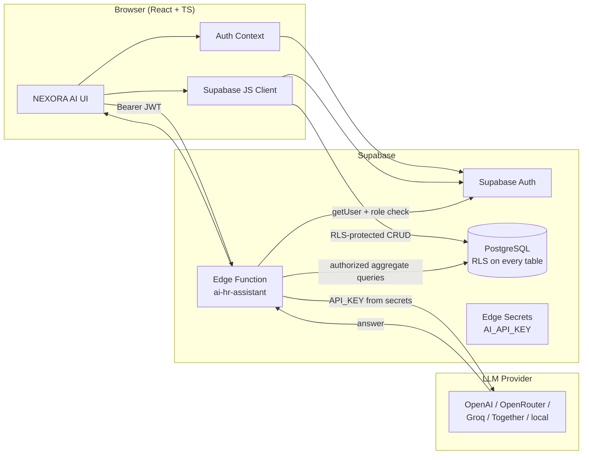

# NEXORA AI — Intelligent Human Resource Management System

> A full-stack, AI-powered HRMS built as a college placement portfolio project.
> Real database persistence, role-based access control enforced at the database
> level, and genuine LLM integration through a secure server-side edge function.

    

---

## Table of Contents

- [Overview](#overview)
- [Features](#features)
- [AI Capabilities](#ai-capabilities)
- [Technology Stack](#technology-stack)
- [Architecture](#architecture)
- [Screenshots](#screenshots)
- [Live Demo](#live-demo)
- [GitHub Repository](#github-repository)
- [Prerequisites](#prerequisites)
- [Installation](#installation)
- [Environment Variables](#environment-variables)
- [Supabase Setup](#supabase-setup)
- [Database Schema](#database-schema)
- [Authentication & RLS](#authentication--rls)
- [AI Provider Configuration](#ai-provider-configuration)
- [Edge Function Deployment](#edge-function-deployment)
- [API Documentation](#api-documentation)
- [Testing](#testing)
- [Deployment Guide](#deployment-guide)
- [Security Considerations](#security-considerations)
- [Known Limitations](#known-limitations)
- [Future Enhancements](#future-enhancements)
- [License](#license)

---

## Overview

NEXORA AI is a modern Human Resource Management System that demonstrates
production-grade web development practices: a typed React frontend, a secure
PostgreSQL schema with Row Level Security on every table, a Supabase Edge
Function that proxies a configurable LLM, and a polished, responsive UI with
light and dark modes.

It is explicitly a **portfolio project**. All employee data is synthetic. Payroll
figures are illustrative and not verified for tax or legal compliance. The
application does not make automated hiring, firing, promotion, or compensation
decisions.

## Features

- **Authentication** — email/password sign-up, sign-in, sign-out, password reset,
  persistent sessions, protected routes.
- **Role-based access control** — four roles (Admin, HR Manager, Department
  Manager, Employee) enforced both in the UI and at the database level via
  Postgres RLS policies.
- **Employee management** — add, view, update, delete employees; search, filter,
  paginate; department assignment; job titles; employment status; employee
  detail view with attendance/leave/payroll tabs.
- **Department management** — full CRUD with live employee counts.
- **Attendance** — daily check-in / check-out, working-hours calculation,
  late-arrival tracking, monthly reports and summaries.
- **Leave management** — leave types, balances, applications, approve/reject
  workflow via a server-side `approve_leave_request()` function that blocks
  self-approval and auto-decrements balances. Notifications on decision.
- **Payroll** — salary records with earnings, deductions, tax, and a generated
  `net_pay` column; monthly payroll history; printable payslips. Restricted to
  admin/HR and the employee themselves.
- **Analytics** — workforce growth, department distribution, attendance trends,
  leave statistics, payroll summaries — all computed from real database rows and
  visualized with Recharts.
- **Notifications** — in-app notifications for leave decisions, with unread
  badge in the sidebar.
- **Settings** — update profile name/phone, toggle light/dark theme.
- **About** — project overview, tech stack, disclaimer.

## AI Capabilities

All AI features run through a single Supabase Edge Function
(`ai-hr-assistant`) that calls a configurable, OpenAI-compatible LLM. No API
keys are exposed to the browser. The LLM never executes SQL.

| Feature | Description |
|---------|-------------|
| **HR Knowledge Assistant (RAG)** | Answers questions using configured HR policy documents via simple keyword retrieval. Says "I don't know" when information is unavailable. Never invents policies. |
| **Employee Self-Service** | Explains leave procedures, attendance rules, and policies in plain language. |
| **Report Summarizer** | Summarizes attendance + leave for the last 30 days, citing the date range and data used. |
| **Natural-Language Analytics** | Answers questions like "How many pending leave requests?" using only pre-fetched, authorized aggregate data. |
| **Job Description Generator** | Generates a complete, editable Markdown JD from job title, department, skills, and experience level. |
| **Workforce Insights** | Identifies trends in aggregate data, clearly separating observations from interpretations. Never makes hiring/firing/promotion decisions. |

If no `AI_API_KEY` is configured, the AI pages show an honest error — the app
never fakes AI responses.

## Technology Stack

| Layer | Technology |
|-------|-----------|
| Frontend | React 18, TypeScript 5, Vite 5, Tailwind CSS 3, Lucide React, Recharts 3 |
| Backend | Supabase (PostgreSQL, Auth, Edge Functions) |
| AI | Configurable OpenAI-compatible LLM via Supabase Edge Function (Deno) |
| Testing | Vitest 1, jsdom |

## Architecture



## Screenshots

> Add screenshots here after your first deployment. Recommended captures:
> the login screen, the dashboard, the employee list, the AI assistant chat,
> analytics charts, and the dark-mode sidebar.


## Live Demo

**Live URL:** https://nexora-ai-hrms-pba2.bolt.host

## GitHub Repository

**Repository URL:** https://github.com/satyam2224/NEXORA-AI-HRMS

> The repository is live at `https://github.com/satyam2224/NEXORA-AI-HRMS`.

## Prerequisites

- Node.js 18+ and npm
- A Supabase project (auto-provisioned in Bolt)
- An LLM API key (optional — app works without it, AI pages show an honest error)

## Installation

```bash
git clone https://github.com/satyam2224/NEXORA-AI-HRMS.git
cd NEXORA-AI-HRMS
npm install
cp .env.example .env   # then fill in your Supabase public keys
npm run dev
```

## Environment Variables

Only two **public** env vars are needed by the frontend (safe to commit in
`.env.example`; real values live in your local `.env` and Bolt's environment):

| Variable | Description |
|----------|-------------|
| `VITE_SUPABASE_URL` | Your Supabase project URL |
| `VITE_SUPABASE_ANON_KEY` | Your Supabase anon (public) key |

**Server-side secrets** (not in `.env`; set in Supabase Edge Function secrets):

| Secret | Description |
|--------|-------------|
| `AI_PROVIDER` | Provider name (`openai`, `groq`, `openrouter`, …) |
| `AI_API_KEY` | Your LLM API key |
| `AI_MODEL` | Model identifier (e.g. `gpt-4o-mini`) |
| `AI_BASE_URL` | OpenAI-compatible base URL (optional) |

See [`docs/AI_SETUP.md`](./docs/AI_SETUP.md) for full details.

## Supabase Setup

The Supabase project is auto-provisioned in Bolt. The schema and RLS policies
are applied via the migration files in `supabase/migrations/`. If you are
setting up a fresh Supabase project, apply the migrations in order using the
Supabase MCP `apply_migration` tool or paste them into the Supabase SQL editor.

Migrations (applied in order):

1. `0001_initial_schema.sql` — all tables, helper functions, RLS policies,
   triggers, and the `approve_leave_request()` function.
2. `0002_auth_trigger_analytics.sql` — auto-create profile on signup, analytics
   view.
3. `0003_security_hardening.sql` — converted the analytics view to
   `SECURITY INVOKER` and pinned `search_path` on the `touch_updated_at`
   trigger function to resolve Supabase security-advisor findings.
4. `0004_revoke_public_execute.sql` — revoked default `PUBLIC` execute on
   `SECURITY DEFINER` functions so unauthenticated users cannot call them via
   `/rest/v1/rpc/`. `approve_leave_request` remains callable by signed-in users.
5. `0005_fix_rls_helper_execute_grants.sql` — re-granted `EXECUTE` on the RLS
   helper functions (`user_role`, `has_role`, `managed_department`,
   `is_manager_of`) to `authenticated`. **This fixed the login bug** where the
   app hung on "Setting up your profile…" — RLS policies run with the caller's
   privileges, so `authenticated` must be able to execute the helper functions
   referenced inside policy expressions.

Synthetic seed data (departments, leave types, HR knowledge documents) is
inserted separately and is clearly labeled as demo data.

## Database Schema

```
profiles            (id PK, email, full_name, role, avatar_url, phone)
  └─ auth.users (FK, cascade)

departments         (id PK, name UNIQUE, description)

employees           (id PK, profile_id FK→profiles, employee_code UNIQUE,
                     department_id FK→departments, job_title,
                     employment_status, is_manager, hire_date,
                     contact_email, contact_phone)

attendance          (id PK, employee_id FK→employees, check_in, check_out,
                     status, notes)
                     constraint: check_out > check_in

leave_types         (id PK, name UNIQUE, description, default_balance, is_paid)

leave_requests      (id PK, employee_id FK→employees, leave_type_id FK→leave_types,
                     start_date, end_date, days, reason, status,
                     approver_id FK→profiles, approved_at, approver_note)
                     constraint: end_date >= start_date

leave_balances      (id PK, employee_id FK, leave_type_id FK, year, balance, used)
                     unique(employee_id, leave_type_id, year)

payroll_records     (id PK, employee_id FK, pay_period_month, pay_period_year,
                     base_salary, earnings, deductions, tax,
                     net_pay GENERATED = base_salary + earnings - deductions - tax,
                     status, payment_date, notes)
                     unique(employee_id, pay_period_month, pay_period_year)

notifications       (id PK, user_id FK→profiles, title, body, type, read, link)

hr_documents        (id PK, title, category, content, tags)
                     -- RAG knowledge base for the AI assistant

analytics_department_distribution  (VIEW)
```

### Helper functions

- `user_role()` — returns the caller's profile role.
- `has_role(text[])` — true if caller's role is in the array.
- `managed_department()` — department id the caller manages.
- `is_manager_of(uuid)` — true if caller manages the given employee's profile.
- `approve_leave_request(uuid, text, text)` — server-side leave decision that
  **blocks self-approval**, checks authorization, updates status, decrements
  the leave balance, and inserts a notification.

## Authentication & RLS

- Supabase email/password auth. Email confirmation OFF by default.
- A trigger auto-creates a `profiles` row on signup with the chosen role (from
  user metadata, defaulting to `employee`).
- **RLS is enabled on every table.** Policies use `auth.uid()` and the helper
  functions above — never `current_user`.
- Employees see only their own attendance, leave, balances, and payroll.
- Department managers see employees in their department and can approve their
  leave.
- HR managers and admins see everything and manage payroll/employees/departments.
- Payroll is the strictest: department managers cannot see salary figures at all.
- Leave self-approval is blocked both in the RLS `WITH CHECK` and in the
  `approve_leave_request()` SQL function.
- **Auth flow resilience** — the frontend `AuthContext` loads the profile with
  an 8-second timeout, surfaces a classified error (`rls` / `network` /
  `not_found`) instead of spinning forever, dedupes concurrent profile loads
  to avoid race conditions, and self-heals a missing profile row via an
  idempotent `upsert(..., { onConflict: 'id' })` (no duplicates). The app
  screen shows a **Try again** button if profile setup fails.

## AI Provider Configuration

See [`docs/AI_SETUP.md`](./docs/AI_SETUP.md). Summary:

1. Pick an OpenAI-compatible provider (OpenAI, Groq, OpenRouter, Together, or a
   local llama.cpp / Ollama server).
2. Set `AI_PROVIDER`, `AI_API_KEY`, `AI_MODEL`, and optionally `AI_BASE_URL` in
   Supabase Edge Function secrets.
3. Open the AI HR Assistant page and ask a question to verify.

## Edge Function Deployment

The `ai-hr-assistant` edge function is deployed via the Supabase MCP
`deploy_edge_functions` tool. Its config lives in `supabase/config.toml`:

```toml
[functions.ai-hr-assistant]
verify_jwt = true
entrypoint = "./functions/ai-hr-assistant/index.ts"
```

`verify_jwt = true` ensures only authenticated users can call it. If you change
the source, redeploy with the MCP tool — it auto-detects changed functions.

## API Documentation

### `POST /functions/v1/ai-hr-assistant`

**Auth:** `Authorization: Bearer <JWT>` (required — `verify_jwt = true`).

**Body:**

```json
{ "action": "chat", "question": "What is the remote work policy?" }
```

| Action | Required fields | Response |
|--------|----------------|----------|
| `chat` | `question` | `{ ok, answer, sources[] }` |
| `jd` | `job_title`, `department?`, `skills?`, `experience_level?` | `{ ok, content }` |
| `summarize` | `range?` (default "last 30 days") | `{ ok, summary, data_range, data_used }` |
| `analytics` | `question` | `{ ok, answer, data_used }` |
| `insights` | — | `{ ok, insights, data_used }` |

**Errors** return `{ ok: false, error: "..." }` with an appropriate HTTP status.
Missing `AI_API_KEY` produces an explicit message naming the missing secret.

## Testing

Tests use Vitest with a jsdom environment and cover the business rules mirrored
from the database/edge-function logic.

```bash
npm run test
```

Test suites:

- `rbac.test.ts` — role access, leave-approval eligibility, payroll/employee
  management permissions.
- `router.test.ts` — hash-route parsing and navigation.
- `business-rules.test.ts` — leave self-approval blocking, attendance
  check-out-after-check-in validation, payroll net-pay calculation, AI action
  input validation.

**Results (as executed): 3 files, 30 tests, all passing.**

Production build and type checks:

```bash
npm run typecheck   # tsc --noEmit
npm run build       # vite build
```

Both pass.

## Deployment Guide

See [`docs/DEPLOYMENT.md`](./docs/DEPLOYMENT.md).

## Security Considerations

- **RLS on every table** — the database is the source of truth for access
  control; the UI is a convenience layer.
- **No API keys in the frontend** — the AI edge function holds keys in Supabase
  Edge Function secrets.
- **The LLM never executes SQL** — only parameterized, server-defined query
  functions fetch aggregate data, which is injected into the prompt.
- **Self-approval blocked server-side** — `approve_leave_request()` raises an
  exception if the approver is the requester.
- **Payroll restricted** — employees see only their own payroll; department
  managers see none.
- **`auth.uid()` everywhere** — never `current_user`.
- **No hardcoded credentials** — no admin account is pre-seeded.
- **Email confirmation OFF** — appropriate for a portfolio demo; turn on for
  production.

## Known Limitations

- **Portfolio project** — payroll figures are illustrative, not tax/legal
  compliant.
- **AI requires an external key** — without `AI_API_KEY`, AI pages show an
  honest error. Get a key per `docs/AI_SETUP.md`.
- **No profile image upload** — avatar initials are used instead (Supabase
  Storage buckets can be added for production).
- **Email confirmation is off** — fine for demos; enable for real deployments.
- **Employee creation flow** — because RLS requires a `profile_id`, a new
  employee must first sign up so a profile row exists, then an admin links the
  employee record. This is intentional for security; production would use an
  invite flow.
- **Single LLM endpoint** — the edge function supports one provider at a time.
- **No mobile app** — responsive web only.

## Future Enhancements

- Supabase Storage for profile images and document uploads.
- An invite-based employee onboarding flow (send a magic link to a new hire).
- Realtime presence on the attendance page.
- Multi-provider routing with fallbacks.
- Exportable reports (CSV/PDF) for attendance, leave, and payroll.
- Email notifications via Supabase Auth + an SMTP provider.
- Org-chart visualization from the manager relationships.

## License

MIT — free to use for learning and portfolio purposes. Provided "as is" without
warranty.
